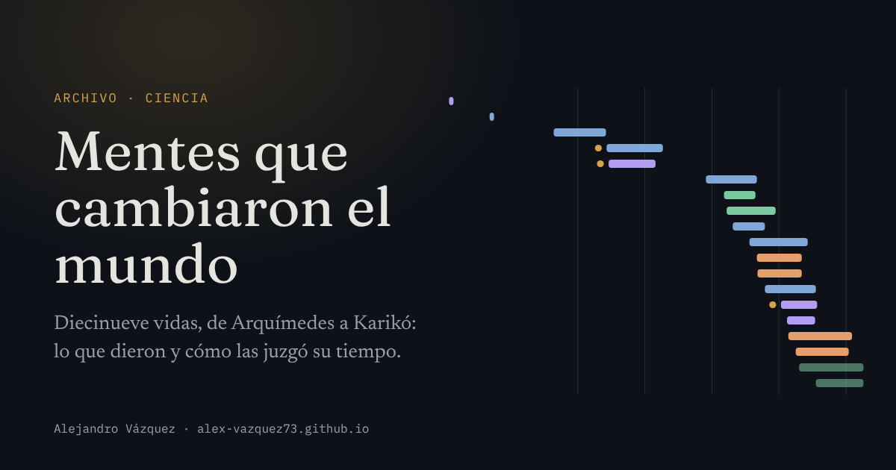

# Mentes que cambiaron el mundo

**[Español](#español) · [English](#english)**

---

## Español

> *Inteligencia, descubrimiento y el precio de tener razón antes de tiempo.*

**Mentes que cambiaron el mundo** reúne a diecinueve personas que descubrieron o inventaron algo para la humanidad, de Arquímedes a Katalin Karikó: lo que dieron, la época que les tocó, su vida íntima y cómo las juzgó su propio tiempo. Un solo archivo HTML con CSS y JavaScript a mano, sin dependencias ni servidor.

### ▶ Abrir

`https://alex-vazquez73.github.io/mentes-brillantes/`

### Qué tiene

- **Una línea de tiempo** con las diecinueve vidas, de 287 a. C. a hoy. Antes de 1500 la escala se comprime.
- **Diecinueve fichas** que se despliegan: qué dio al mundo, su época, su vida íntima, cómo la veían y una provocación final. Con filtros por área, por reconocimiento tardío, por legado ambiguo y por podio.
- **Un podio, como curiosidad:** Leibniz, Newton y von Neumann, cada uno por una razón distinta, con los cuatro criterios a la vista y una tabla de lo que hacía cada uno a la misma edad.
- **Un criterio honesto sobre el CI:** solo se muestra la estimación histórica de Catharine Cox (1926) donde existe. Nunca se inventa una cifra.
- **Rigor visible:** las anécdotas de fuente única llevan la marca «se cuenta» y las que casi seguro no ocurrieron, «leyenda». Cada ficha cita sus fuentes.

### Cómo está hecho

`index.html` se genera a partir de un texto en Markdown con un script de Python; los datos van incluidos en la página y también en `datos.json`. El texto y el código son obra de Alejandro Vázquez, escritos con ayuda de Claude.

El código está bajo licencia MIT. Los textos de las fichas están bajo [CC BY 4.0](https://creativecommons.org/licenses/by/4.0/deed.es): se pueden compartir y adaptar citando al autor.

---

## English

> *Intelligence, discovery and the price of being right too early.*

**Mentes que cambiaron el mundo** ("Minds that changed the world") is an interactive collection, in Spanish, of nineteen people who discovered or invented something for humanity, from Archimedes to Katalin Karikó: what they gave, the era they lived in, their private lives and how their own time judged them. A single hand-written HTML file, no dependencies, no server.

**Open:** `https://alex-vazquez73.github.io/mentes-brillantes/`

- A **timeline** of the nineteen lives, nineteen expandable **profiles** with filters, and a tongue-in-cheek **podium** (Leibniz, Newton, von Neumann) built on four visible criteria.
- **An honest stance on IQ:** only Catharine Cox's 1926 historical estimates are shown, where they exist. No number is invented.
- Anecdotes from a single or late source are labeled; every profile cites its sources.

The code is MIT-licensed. The profile texts are licensed under [CC BY 4.0](https://creativecommons.org/licenses/by/4.0/).

---

Alejandro Vázquez · [Archivo](https://alex-vazquez73.github.io/) · 2026
